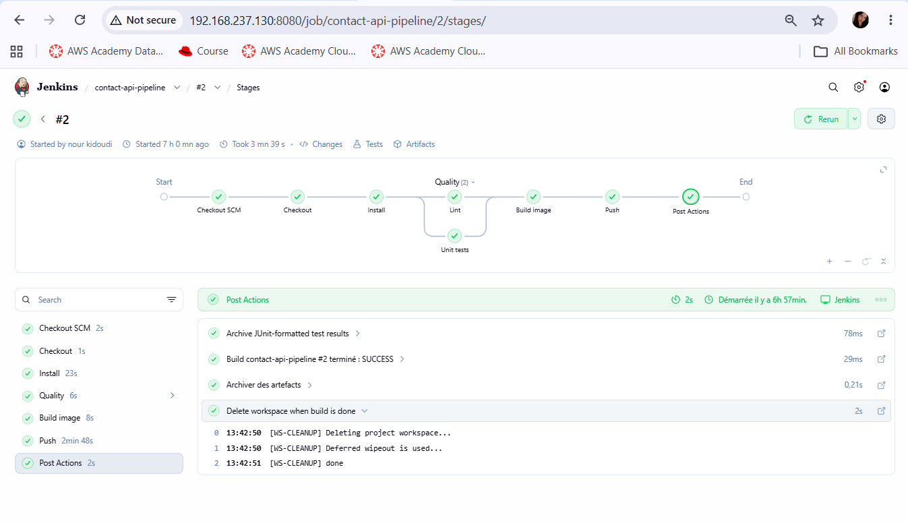
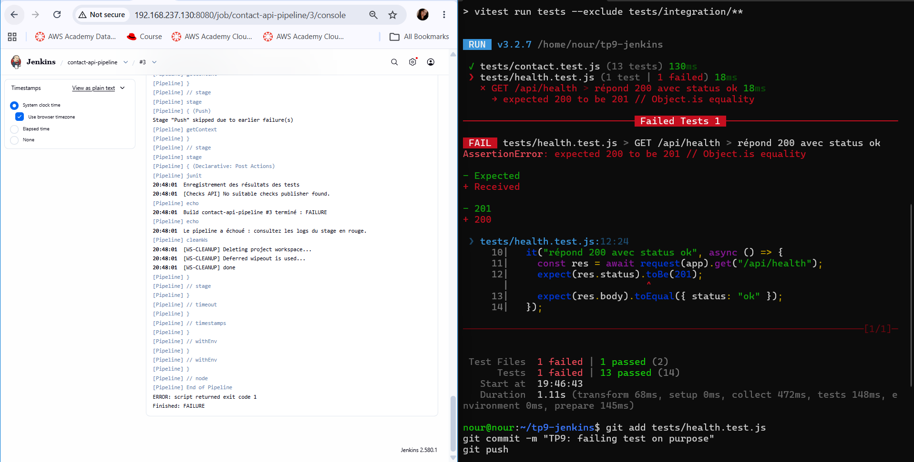
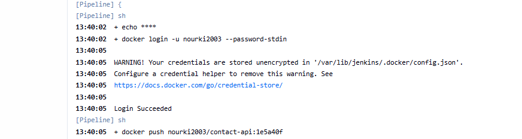
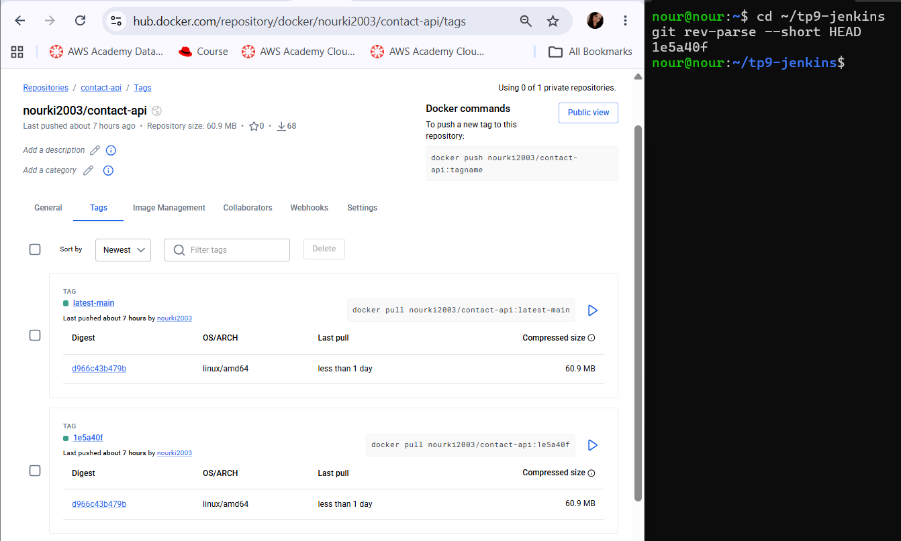
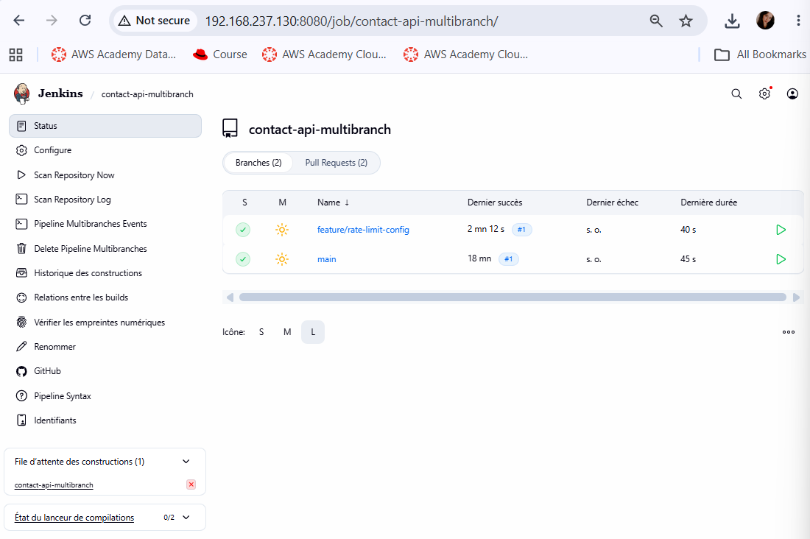
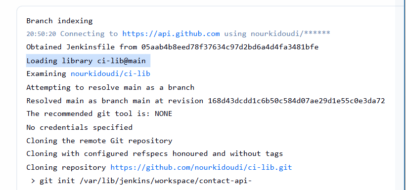

# TP9 : Pipeline as Code avec Jenkins

Pipeline Jenkins décrit dans le dépôt (`Jenkinsfile`) pour l'API `contact-api` du TP8 : stages, exécution parallèle, agents Docker, credentials, blocs `post`, artefacts, image taguée avec le Git SHA, puis job **Multibranch** relié à GitHub.

**Auteure :** Nour Kidoudi — Master DevOps et Cloud Computing, ISET Tozeur

## Stack

Jenkins LTS · Docker · Node.js 24 (Express 5) · Vitest + Supertest · ESLint · Docker Hub · GitHub

## Contenu du dépôt

| Fichier | Rôle |
|---|---|
| `Jenkinsfile` | Pipeline déclaratif (Pipeline as Code) |
| `Dockerfile` | Build multi-stage (deps, runtime), utilisateur `node`, `HEALTHCHECK` |
| `.dockerignore` | Exclut `node_modules`, `.env`, `.git`, `reports`, `coverage` |
| `eslint.config.js` | Configuration ESLint (lint du projet) |
| `src/`, `tests/`, `migrations/` | Code de l'API `contact-api` et ses tests (TP8) |
| `captures/` | Captures d'écran des livrables |

## Environnement

- Jenkins installé en service sur la VM (`http://192.168.237.130:8080`), Docker sur la même machine.
- L'utilisateur `jenkins` peut lancer Docker :

```bash
sudo usermod -aG docker jenkins && sudo systemctl restart jenkins
sudo -u jenkins docker ps
```

- Plugins : Pipeline, Git, GitHub Branch Source, Docker Pipeline, JUnit, Credentials Binding, Workspace Cleanup, Timestamper.
- Credential Jenkins `dockerhub` (type *Username with password*) : identifiant Docker Hub + **access token** (pas le mot de passe).
- Image publiée : `nourki2003/contact-api` (https://hub.docker.com/r/nourki2003/contact-api).

## Préparation du projet

Le projet du TP8 a été copié dans ce dépôt, puis complété :

1. **Lint** : `npm i -D eslint @eslint/js globals`, script `lint` (`eslint .`) et `eslint.config.js`. Le test `refuse un champ manquant` utilise `const { message, ...incomplete } = valid;` pour retirer volontairement un champ : la règle `no-unused-vars` est donc configurée avec `ignoreRestSiblings: true`.
2. **Dockerfile** multi-stage (étape `deps` avec `npm ci --omit=dev`, puis image d'exécution), utilisateur non-root `node`, port 4000, `HEALTHCHECK` sur `/api/health`.
3. Vérification en local : `npm run lint`, `npm test` (14 tests) et `docker build -t contact-api:test .` passent.

## Partie 1 : Premier pipeline depuis le dépôt

Job **Pipeline** `contact-api-pipeline` :

- Definition : *Pipeline script from SCM*
- SCM : Git, URL `https://github.com/nourkidoudi/tp9-jenkins.git`
- Branche : `*/main`
- Script Path : `Jenkinsfile`

## Partie 2 : Agents Docker, parallélisme et rapports

Le `Jenkinsfile` enchaîne les stages suivants :

| Stage | Rôle |
|---|---|
| Checkout | `checkout scm`, calcul de `SHORT_SHA` (7 premiers caractères de `GIT_COMMIT`) |
| Install | `npm ci` dans un agent `node:24-alpine` (`reuseNode true`) |
| Quality | Bloc `parallel` : **Lint** et **Unit tests** (agents Docker) |
| Build image | `docker build` avec le label `org.opencontainers.image.revision`, écriture de `image.txt` |
| Push | `docker push` uniquement sur `main`, avec `withCredentials` |

Autres éléments :

- `options` : `timestamps()`, `timeout`, `buildDiscarder`, **`disableConcurrentBuilds()`**.
- Rapport JUnit : `npx vitest run tests --exclude "tests/integration/**" --reporter=default --reporter=junit --outputFile.junit=reports/junit.xml`, publié dans `post { always { junit … } }`. Les tests d'intégration (qui exigent PostgreSQL) sont exclus, comme dans `npm test`.
- `post` : `always` (JUnit), `success` (`archiveArtifacts image.txt`), `failure` (message), `cleanup` (`cleanWs()`).

### Problèmes rencontrés

- **« En attente du prochain exécuteur disponible »** : le build #1 attendait un exécuteur Jenkins ; il s'est lancé dès qu'un exécuteur a été disponible.
- **`npm error EACCES … /.npm`** dans le stage Install : le conteneur `node:24-alpine` tourne avec l'utilisateur Jenkins (`105:108`), sans répertoire personnel, et npm ne peut pas écrire son cache dans `/.npm`. Correction : variable d'environnement `NPM_CONFIG_CACHE = '/tmp/.npm'` dans le bloc `environment` du `Jenkinsfile`. Le build #2 est passé.

### Vue des stages (Lint et Unit tests en parallèle)



### Rapport JUnit : test volontairement en échec

Pour vérifier le comportement en cas d'échec, `tests/health.test.js` a été modifié (`toBe(200)` remplacé par `toBe(201)`). Résultat :

- le stage **Unit tests** passe au rouge ;
- les stages **Build image** et **Push** sont sautés (*skipped*) ;
- le bloc `failure` s'exécute ;
- l'onglet **Tests** affiche le test en échec.



Le test a ensuite été corrigé (`git revert`) et le build est repassé au vert :


## Partie 3 : Image taguée avec le Git SHA, credentials et push

- `SHORT_SHA` est calculé après le checkout : `env.SHORT_SHA = env.GIT_COMMIT.take(7)`.
- L'image est construite sous `${IMAGE_NAME}:${SHORT_SHA}` avec le label `org.opencontainers.image.revision=${GIT_COMMIT}`.
- Le push se fait **uniquement sur `main`** (`when { expression { env.BRANCH_NAME == 'main' || env.GIT_BRANCH == 'origin/main' } }`) : `BRANCH_NAME` existe en Multibranch, `GIT_BRANCH` dans un job *Pipeline from SCM*.
- Le credential est injecté avec `withCredentials`, et les commandes `sh` qui manipulent des secrets utilisent des **guillemets simples** : c'est le shell, et non Groovy, qui remplace les variables, donc le secret n'apparaît pas dans le script interpolé.

```groovy
withCredentials([usernamePassword(credentialsId: 'dockerhub',
                  usernameVariable: 'DH_USER', passwordVariable: 'DH_TOKEN')]) {
  sh 'echo "$DH_TOKEN" | docker login -u "$DH_USER" --password-stdin'
  sh 'docker push "$IMAGE_NAME:$SHORT_SHA"'
}
```

- `docker logout` est exécuté à la fin du stage (bloc `post { always }`).
- Le fichier `image.txt`, qui contient la référence complète de l'image, est archivé avec `archiveArtifacts`.

### Token masqué dans la console

Dans la *Console Output*, le token Docker Hub apparaît sous la forme `****` :



### Tag de l'image sur Docker Hub = Git SHA

Le tag publié sur Docker Hub correspond à la sortie de `git rev-parse --short HEAD` :



## Partie 4 : Multibranch Pipeline

Le job **Multibranch Pipeline** scanne GitHub et crée un job par branche et par Pull Request.

1. Création d'un credential GitHub (*Username with password* : identifiant GitHub + fine-grained personal access token en lecture seule sur le dépôt), si le dépôt est privé.
2. Création du job Multibranch : source **GitHub**, dépôt `tp9-jenkins`. Dans *Scan Multibranch Pipeline Triggers*, **Periodically if not otherwise run** toutes les **2 minutes**.
3. La VM de lab n'est pas joignable depuis Internet : GitHub ne peut pas appeler Jenkins par webhook, le **scan périodique** remplace donc le webhook.
4. Création de la branche `feature/rate-limit-config`, push, ouverture d'une Pull Request : apparition des jobs `feature/rate-limit-config` et `PR-1`.
5. Le stage **Push** est sauté (*skipped*) sur la branche et sur la PR, et exécuté sur `main` après le merge.



## Défi : Shared Library Jenkins

Les étapes `docker build` / `docker push` sont extraites dans une Shared Library (`ci-lib`, fichier `vars/buildAndPush.groovy`), enregistrée dans *Global Trusted Pipeline Libraries* et chargée dans le Jenkinsfile avec `@Library('ci-lib') _`.



## Livrables

| Fichier | Contenu |
|---|---|
| `captures/pipeline-stages.png` | Vue des stages avec Lint et Unit tests en parallèle |
| `captures/junit-report.png` | Onglet Tests avec un test en échec (puis corrigé : `junit-report-ok.png`) |
| `captures/credentials-masked.png` | Console où le token Docker Hub apparaît sous forme `****` |
| `captures/dockerhub-sha-tag.png` | Image `contact-api:<sha>` sur Docker Hub + `git rev-parse --short HEAD` |
| `captures/multibranch.png` | Jobs `main`, `feature/…` et `PR-1` dans le Multibranch |
| `Jenkinsfile` | Jenkinsfile final |

## Lancer le pipeline

```bash
git clone https://github.com/nourkidoudi/tp9-jenkins.git
cd tp9-jenkins
npm ci && npm run lint && npm test
docker build -t contact-api:test .
```

Puis, dans Jenkins : créer le credential `dockerhub`, créer le job *Pipeline script from SCM* (ou *Multibranch Pipeline*) pointant vers ce dépôt, et lancer **Build Now**.


